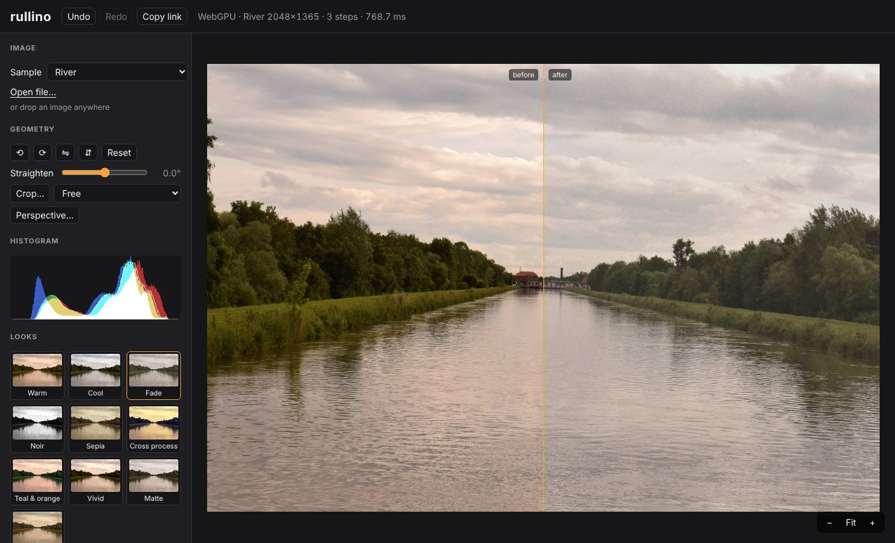

# rullino

[](https://github.com/Stocastico/rullino/actions/workflows/ci.yml) [](./LICENSE) [](https://stocastico.github.io/rullino/)

GPU-first image processing for the web, built on **WebGPU** and written in **TypeScript**.

rullino spans the arc from classic computer-vision operations (thresholds, convolutions, Canny edges, morphology, median, bilateral, CLAHE) to photo-app adjustments and looks (exposure, curves, white balance, LUT-based "insta" presets, vignette, grain), with a few optional AI tools. A companion **playground** lets you load a photo, chain filters and tweak their parameters live: **[try it](https://stocastico.github.io/rullino/)**. Photos are processed on your machine and never uploaded.

[](https://stocastico.github.io/rullino/)

> **Status:** pre-alpha, working towards a first `0.1.0` release (see [PLAN.md](./PLAN.md)). What exists:
> - **Core**: schema-driven parameters, `defineFilter()`, filter chains with pointwise fusion and incremental recompute, masks, geometry (crop, perspective, straighten), 3D LUTs, export to PNG (8/16-bit), JPEG and WebP, share-link serialisation.
> - **Filters**: adjustments (exposure, curves, levels, white balance, colour mixer, grading...), convolutions, edges (Canny, Sobel / Scharr / Prewitt, Laplacian), thresholds, morphology, median, bilateral, histogram equalisation / CLAHE, inpainting, stylize (halftone, dither, Kuwahara, bloom...), lens blur.
> - **Presets**: ten looks built from a LUT recipe, vignette and grain.
> - **ML (optional, `@rullino/ml`)**: click-to-select objects (SlimSAM), object removal (MI-GAN) and depth for lens blur (Depth Anything V2 Small), with ONNX Runtime passed in by the caller.
> - **Playground**: chain editor, masks (brush, wand, Object), zoom, undo / redo, share links.
>
> Not published to npm yet. Input is 8-bit sRGB (what the browser decodes); not done yet: Hough and other analysis filters, video input. See [PLAN.md](./PLAN.md).

## Why

| Existing | Problem |
|---|---|
| OpenCV.js | WASM, several MB, translated C++ API, no GPU |
| glfx.js | WebGL1, unmaintained since 2015 |
| CamanJS | abandoned, CPU only |
| pixi-filters | tied to the Pixi renderer |

rullino aims to be modern, typed, composable and GPU-first, with zero runtime dependencies.

## Design highlights

- **Two implementations per filter**: a WGSL compute shader (fast) and a plain TypeScript CPU version (reference). Tests check GPU ↔ CPU parity pixel by pixel; the CPU path doubles as a fallback.
- **Correct color**: linear `rgba16float` internal pipeline, sRGB decode/encode at the edges, OKLab/OKLCH for perceptual adjustments, premultiplied alpha.
- **Schema-driven parameters**: each filter declares typed parameters with ranges and defaults; the playground UI, validation and URL serialization are generated from them.
- **Looks are data**: Instagram-style filters are presets built from a 3D LUT engine plus vignette and grain.
- **Pass graph**: consecutive pointwise filters are fused into one shader; changing a parameter only recomputes downstream nodes.

## Layout

```
packages/
  core/        WebGPU device, texture pool, pass graph, color conversions, I/O
  filters/     one module per filter: schema + WGSL + CPU reference
  presets/     looks = LUT + parameters
  ml/          optional ML tools (select, remove, depth); ONNX Runtime is passed in, never imported
apps/
  playground/  Vite demo site
```

## Install

Not on npm yet; once published:

```sh
npm install @rullino/core @rullino/filters
npm install -D @webgpu/types   # TypeScript only: the declarations mention GPUDevice, GPUTexture...
```

The per-package READMEs below have the quick starts.

## Documentation

- [Filter reference](./docs/filters.md): every filter with its parameters, ranges and defaults, generated from the schemas.
- Per package: [core](./packages/core/README.md), [filters](./packages/filters/README.md), [presets](./packages/presets/README.md), [ml](./packages/ml/README.md). Their `ts` examples are type-checked against the sources.
- [PLAN.md](./PLAN.md) for the design and roadmap, [CLAUDE.md](./CLAUDE.md) for conventions and the reasoning behind decisions.

## Development

Requirements: Node.js ≥ 22.12, pnpm 10, a browser with WebGPU (recent Chrome/Edge, or Safari/Firefox with WebGPU enabled).

```sh
pnpm install
pnpm dev              # playground at http://localhost:5173
pnpm typecheck
pnpm test             # unit tests (Node)
pnpm test:browser     # GPU tests in headless Chromium, incl. GPU <-> CPU parity
pnpm build
pnpm test:e2e         # smoke test of the built playground
pnpm test:coverage    # unit + browser tests with coverage thresholds
pnpm test:ml          # the real ML models on ONNX Runtime WASM (downloads ~69 MB once)
```

Browser tests need Playwright's Chromium (`pnpm exec playwright install chromium`). WebGPU runs on SwiftShader when no GPU is present, so they also work in CI.

See [CLAUDE.md](./CLAUDE.md) for conventions and the reasoning behind key decisions.

## License

[MIT](./LICENSE). The ML models are downloaded at run time under their own licences, see [THIRD_PARTY_NOTICES.md](./THIRD_PARTY_NOTICES.md).
