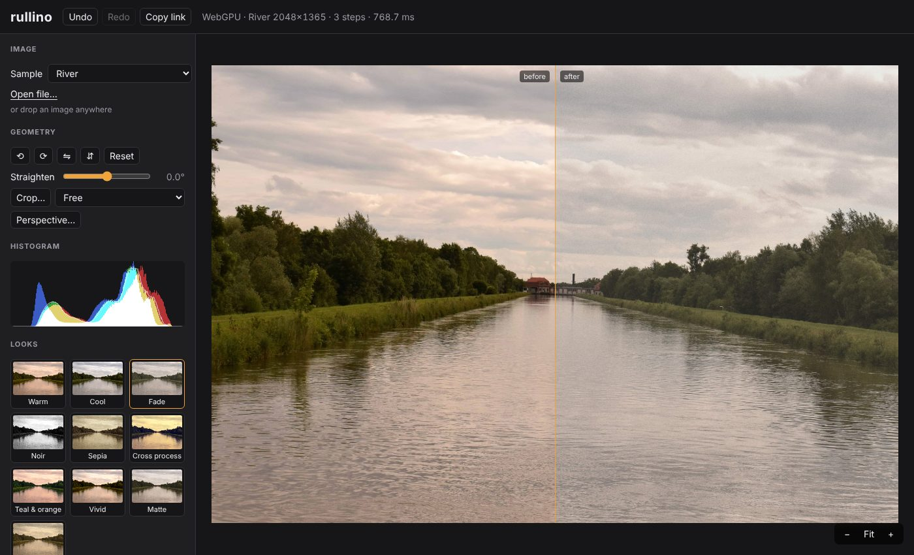

# rullino

[](https://github.com/Stocastico/rullino/actions/workflows/ci.yml) [](./LICENSE) [](https://stefanomasneri.com/rullino/) [](./docs/parity.md)

Describe a photo edit once, as JSON. **Preview it live on the GPU** in the browser, **render the final file on a server**, or **replay it on the CPU** wherever there is no GPU, with output that agrees within a [published per-filter tolerance](./docs/parity.md). TypeScript, WebGPU, MIT, no runtime dependencies.

51 filters cover classic image processing (blurs, Canny edges, thresholds, morphology, median, bilateral, CLAHE) and photo-app adjustments and looks (exposure, curves, white balance, colour grading, LUTs, vignette, grain), plus masks, crop / perspective geometry, export to PNG / JPEG / WebP and a few optional on-device AI tools. The **[playground](https://stefanomasneri.com/rullino/)** shows them on your own photo (it never leaves your machine); the **[API reference](https://stefanomasneri.com/rullino/docs/)** is generated from the sources.

[](https://stefanomasneri.com/rullino/)

## Quick start

An edit is a JSON document. Write it once, render it wherever you need the picture:

```json
{
  "version": 2,
  "steps": [
    { "filter": "exposure", "params": { "ev": 0.3 } },
    { "filter": "contrast", "params": { "amount": 0.15 } },
    { "filter": "vignette", "params": {} }
  ],
  "output": { "format": "jpeg", "quality": 0.9, "longSide": 2048 }
}
```

**In the browser** (`npm install @rullino/web`): WebGPU when the browser has it, otherwise the same edit on the CPU in a Web Worker.

```ts
import { createRenderer } from '@rullino/web';

const edit = {
  version: 2,
  steps: [
    { filter: 'exposure', params: { ev: 0.3 } },
    { filter: 'contrast', params: { amount: 0.15 } },
    { filter: 'vignette', params: {} },
  ],
  output: { format: 'jpeg', quality: 0.9, longSide: 2048 },
};

const renderer = await createRenderer(); // create it once; renderer.backend is 'gpu' or 'cpu'
export const develop = (photo: File): Promise<Blob> => renderer.render(photo, edit);
```

**On a server** (`npm install @rullino/node sharp`, plus `webgpu` for the GPU): the same document, the same shaders through Dawn, or the CPU.

```ts
import { readFile, writeFile } from 'node:fs/promises';
import { createRenderer } from '@rullino/node';

const renderer = await createRenderer();
export async function develop(input: string, edit: unknown, output: string): Promise<void> {
  await writeFile(output, (await renderer.render(await readFile(input), edit)).bytes);
}
```

**In code** (`npm install @rullino/core @rullino/filters`): the same filters as steps of a chain, on the GPU or the CPU.

```ts
import { applyEdit, createImage, serializeChain } from '@rullino/core';
import { contrast, exposure, filters } from '@rullino/filters';

const edit = serializeChain(
  [{ filter: exposure, params: { ev: 0.3 } }, { filter: contrast, params: { amount: 0.15 } }],
  { output: { format: 'png', longSide: 2048 } },
); // the JSON above, from filter objects: defaults are left out

const image = createImage(2, 1, Float32Array.from([0.1, 0.2, 0.3, 1, 0.4, 0.2, 0.1, 0.5])); // linear, premultiplied RGBA
const result = await applyEdit(image, edit, { filters }); // on the CPU; pass { gpu: ctx } to render with WebGPU
```

GPU and CPU agree within a tolerance each filter declares: see the [parity table](./docs/parity.md). The [Getting started guide](./docs/getting-started.md) has the details for each path, the `Pipeline` API for custom GPU work is in the [core README](./packages/core/README.md), and [`@rullino/konva`](./packages/konva/README.md) edits a `Konva.Image` in place.

## Packages

| Package | What it is | You need it when |
|---|---|---|
| [`@rullino/web`](./packages/web/README.md) | Browser renderer: WebGPU, else the CPU in Web Workers (with band threads) | you render edits in a web page |
| [`@rullino/node`](./packages/node/README.md) | Node renderer: the same shaders on Dawn, else the CPU (worker threads); files in and out through `sharp` | you render on a server or in a script |
| [`@rullino/konva`](./packages/konva/README.md) | `attachEdit(node)`: a `Konva.Image` edited with documents, previews at screen size, full-resolution export | you build on Konva |
| [`@rullino/core`](./packages/core/README.md) | The engine: edit documents, `Pipeline`, masks, geometry, LUTs, colour maths, export, `defineFilter` | you want the low-level API or to write filters |
| [`@rullino/filters`](./packages/filters/README.md) | 51 filters, each a WGSL shader plus a TypeScript reference | you pick filters yourself (the renderers include them) |
| [`@rullino/presets`](./packages/presets/README.md) | Ten looks (LUT + vignette + grain) as steps, edit documents and `.cube` baking | you want ready-made looks |
| [`@rullino/ml`](./packages/ml/README.md) | Optional on-device ML: select an object, remove an object, depth for lens blur (ONNX Runtime passed in) | you want those tools |

All packages share one version number, are ESM only and have **no runtime dependencies**.

> **Status: 0.x.** The API may still change between minor versions (changes are in the [changelog](./CHANGELOG.md)); `@rullino/core/internal` and `@rullino/ml/internal` are plumbing without a stability promise. Input is 8-bit sRGB (what the browser decodes); 16-bit PNG is supported as output. Not done: 16-bit / HDR input, analysis filters such as Hough, video input. See [PLAN.md](./PLAN.md).

## Why

Image processing in the browser is well served by general tools; what is missing is a **WebGPU-first, typed filter library with a specification you can test against**. The closest alternatives, by what they are built for:

| Library | Approach | Note |
|---|---|---|
| OpenCV.js | WASM, CPU; broad computer-vision toolkit | Much wider scope than filters; no GPU path in current releases |
| glfx.js | WebGL 1 filters | Last npm release 2016, last commit 2022 |
| CamanJS | Canvas pixel manipulation (CPU) | Marked no longer maintained in 2020; last npm release 2013 |
| pixi-filters | Filters for PixiJS (WebGL; WebGPU through Pixi v8) | Meant to be used inside a Pixi scene |
| three.js / Babylon.js post-processing | Scene-graph post-process nodes (WebGPU or WebGL) | Built for 3D rendering |
| Jimp, sharp, wasm-vips, magick-wasm | CPU image processing (JS, native or WASM) | Server-side or batch oriented; no GPU |
| Fabric.js, Konva | Canvas libraries with built-in filters | Object model first, filters second |
| small WebGPU filter repos | Demos and single-purpose tools (for example LUT-only) | Not published as general libraries, as far as we could find |

rullino is modern, typed, composable and GPU-first, with zero runtime dependencies: every filter is a WebGPU compute shader **and** a plain TypeScript reference, tested against each other; filters chain into fused shaders; masks, geometry, 3D LUTs and export are part of the same model. The trade-off is that it needs WebGPU (no WebGL fallback). *Comparison last checked in October 2026; corrections welcome.*

## Design highlights

- **Two implementations per filter**: a WGSL compute shader (fast) and a plain TypeScript CPU version (reference). Tests check GPU ↔ CPU parity pixel by pixel, within a tolerance each filter declares and the [parity table](./docs/parity.md) publishes (not bit-identical: the GPU keeps intermediates in float16); the CPU path doubles as a fallback.
- **Correct color**: linear `rgba16float` internal pipeline, sRGB decode/encode at the edges, OKLab/OKLCH for perceptual adjustments, premultiplied alpha.
- **Schema-driven parameters**: each filter declares typed parameters with ranges and defaults; the playground UI, validation and URL serialization are generated from them.
- **Looks are data**: Instagram-style filters are presets built from a 3D LUT engine plus vignette and grain.
- **Pass graph**: consecutive pointwise filters are fused into one shader; changing a parameter only recomputes downstream nodes.

## Documentation

- **Start here**: [Getting started](./docs/getting-started.md) · [Concepts](./docs/concepts.md) · [The edit document](./docs/edit-document.md) · [Troubleshooting](./docs/troubleshooting.md).
- **Guides by job**: [preview and export in the browser](./docs/guides/preview-and-export.md) · [the same edit on the server](./docs/guides/same-edit-on-the-server.md) · [looks and LUTs in your editor](./docs/guides/looks-in-your-editor.md) · [remove an object on-device](./docs/guides/remove-an-object.md) · [migrating from glfx.js and tui.image-editor](./docs/guides/migrating-from-glfx-and-tui.md).
- **Reference**: [filters](./docs/filters.md) (parameters, ranges, defaults; generated from the schemas) · [parity table](./docs/parity.md) (how far GPU and CPU may differ, per filter) · [API](https://stefanomasneri.com/rullino/docs/) (generated from the sources) · the edit document's [JSON Schema](./packages/core/edit.schema.json).
- **Examples**: [Konva photo editor](https://github.com/Stocastico/rullino/tree/main/examples/konva-editor) ([StackBlitz](https://stackblitz.com/github/Stocastico/rullino/tree/main/examples/konva-editor?file=main.js)), [Next.js: preview in the browser, render on the server](https://github.com/Stocastico/rullino/tree/main/examples/nextjs-server-render), [Node batch](https://github.com/Stocastico/rullino/tree/main/examples/node-batch), [CPU fallback in a worker](https://github.com/Stocastico/rullino/tree/main/examples/worker-fallback). Their `ts` examples and the documentation's are type-checked against the sources.
- **Project**: [PLAN.md](./PLAN.md) (design and roadmap) · [CLAUDE.md](./CLAUDE.md) (conventions and the reasoning behind decisions) · [CHANGELOG.md](./CHANGELOG.md) · [CONTRIBUTING.md](./CONTRIBUTING.md) · [SECURITY.md](./SECURITY.md).

## Development

Requirements: Node.js ≥ 22.12, pnpm 10, a browser with WebGPU (recent Chrome/Edge, or Safari/Firefox with WebGPU enabled).

```sh
pnpm install
pnpm dev              # playground at http://localhost:5173
pnpm typecheck
pnpm test             # unit tests (Node)
pnpm test:browser     # GPU tests in headless Chromium, incl. GPU <-> CPU parity
pnpm build
pnpm test:e2e         # smoke test of the built playground
pnpm test:coverage    # unit + browser tests with coverage thresholds
pnpm test:ml          # the real ML models on ONNX Runtime WASM (downloads ~69 MB once)
```

Browser tests need Playwright's Chromium (`pnpm exec playwright install chromium`). WebGPU runs on SwiftShader when no GPU is present, so they also work in CI.

See [CLAUDE.md](./CLAUDE.md) for conventions and the reasoning behind key decisions.

## License

[MIT](./LICENSE). The ML models are downloaded at run time under their own licences, see [THIRD_PARTY_NOTICES.md](./THIRD_PARTY_NOTICES.md).
